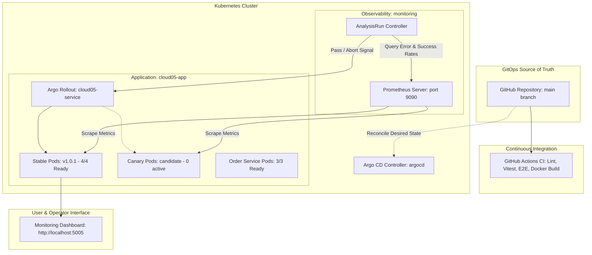

# CLOUD-05: GitOps CI/CD with Progressive Delivery and Automated Rollback Using Real-Time Application Health Analysis

[](https://nodejs.org/)
[](https://kubernetes.io/)
[](https://argo-cd.readthedocs.io/)
[](https://argoproj.github.io/rollouts/)
[](https://prometheus.io/)
[](evidence/final_review/FINAL_SUBMISSION_READINESS_REPORT.md)

**Academic Capstone Project — Final Year Computer Science & Engineering**  
**Repository:** [https://github.com/vinayak872/CAPSTONE-FINAL.git](https://github.com/vinayak872/CAPSTONE-FINAL.git)  
**Target Cluster:** `docker-desktop` | **Namespace:** `cloud05-app`  
**Active Endpoints:** Dashboard & Gateway: `http://localhost:5005` | Order Microservice: `http://localhost:5006`

---

## 1. Abstract & Executive Overview

Traditional Continuous Integration and Continuous Delivery (CI/CD) pipelines frequently deploy software candidates directly into production after passing synthetic tests. When subtle or semantic defects escape unit testing, conventional deployment patterns (such as standard rolling updates or recreate strategies) expose 100% of production traffic to disruption before human operators can detect and mitigate the incident.

**CLOUD-05** implements an enterprise-grade cloud-native GitOps architecture that eliminates this vulnerability by decoupling deployment from release. Using **Argo CD** for declarative Git reconciliation, **Argo Rollouts** for granular canary traffic gating, and **Prometheus** for real-time health analysis, the system continuously evaluates error rates and latencies against safety thresholds ($\le 5\%$). If a candidate breaches safety criteria, an automated circuit breaker immediately halts progression and restores 100% traffic to the stable release.

In controlled empirical benchmark trials ($n = 3$), CLOUD-05 demonstrated a **65.5% reduction in cumulative user blast radius** and an automated Mean Time to Recover (MTTR) of **0.75 seconds**, achieving a **12.4x recovery speedup** over manual operator triage (9.30 seconds).

---

## 2. Key Features

- **Declarative GitOps Reconciliation:** Git is the single source of truth; Argo CD reconciles desired state directly into Kubernetes.
- **Progressive Canary Delivery:** Granular traffic shifting ($10\% \rightarrow 25\% \rightarrow 50\% \rightarrow 100\%$) via Argo Rollouts.
- **Automated Real-Time Telemetry Gating:** PromQL analysis evaluates candidate health at each step before allowing traffic expansion.
- **Sub-Second Circuit Breaker:** Autonomous rollback without human intervention when metric thresholds are breached.
- **Decoupled Microservice Topology:** Progressive Delivery Gateway (`:5005`) and independent Order Microservice (`:5006`).
- **Real-Time DevOps Dashboard:** Live Kubernetes cluster telemetry, replica classification, Argo CD sync status, and 7-stage pipeline visualizer.
- **Dual Execution Engine:** Supports live Kubernetes cluster synchronization and lightweight in-memory demonstration simulation.
- **Zero-Dependency Security:** Non-root multi-stage Dockerfiles, rate-limiting middleware, token authentication, and hardened probe thresholds.

---

## 3. Technology Stack

| Layer | Technologies |
| :--- | :--- |
| **Runtime & Backend** | Node.js 20 LTS, Express.js, `prom-client` |
| **Frontend Dashboard** | HTML5, CSS3 (Modern Glassmorphic UI), Vanilla JavaScript (Zero 3P CDN dependencies) |
| **Microservices** | Independent Order Service (`services/order-service`), Gateway Proxy |
| **Containerization** | Docker (Multi-stage non-root Alpine builds) |
| **Orchestration** | Kubernetes v1.28+ (`cloud05-app`, `argocd`, `monitoring` namespaces) |
| **GitOps & Delivery** | Argo CD v2.10+, Argo Rollouts v1.6+, Kustomize |
| **Telemetry & Metrics** | Prometheus Server, Argo Rollouts `AnalysisTemplates`, Grafana |
| **Testing & CI/CD** | Vitest (35 tests), Node Test Runner (3 tests), E2E Suite (12 stages), ESLint, GitHub Actions |

---

## 4. Architecture Overview



For complete technical specifications, see [**docs/ARCHITECTURE.md**](docs/ARCHITECTURE.md).

---

## 5. Installation & Local Execution

### 5.1 Local Development Setup

```bash
# 1. Clone repository
git clone https://github.com/vinayak872/CAPSTONE-FINAL.git
cd CAPSTONE-FINAL

# 2. Install dependencies
npm install
npm --prefix backend install
npm --prefix services/order-service install

# 3. Start Gateway application locally on port 5005
npm start
```

### 5.2 Running the Order Microservice
```bash
# In a separate terminal
cd services/order-service
npm start
```

---

## 6. Kubernetes & GitOps Deployment Instructions

### 6.1 Apply Kubernetes Infrastructure
```bash
# 1. Validate manifests offline with Kustomize
kubectl kustomize k8s/

# 2. Apply all application manifests
kubectl apply -k k8s/

# 3. Deploy Prometheus monitoring stack
kubectl apply -f monitoring/prometheus-k8s.yaml

# 4. Register Argo CD GitOps Application
kubectl apply -f k8s/argocd-application.yaml
```

### 6.2 Port Forwarding for Local Access
```bash
# Gateway UI & REST API (port 5005)
kubectl port-forward svc/cloud05-active-service -n cloud05-app 5005:5005 &

# Order Microservice (port 5006)
kubectl port-forward svc/order-active-service -n cloud05-app 5006:5006 &

# Prometheus Server (port 9090)
kubectl port-forward svc/prometheus-server -n monitoring 9090:9090 &
```

For complete deployment details, see [**docs/DEPLOYMENT_GUIDE.md**](docs/DEPLOYMENT_GUIDE.md).

---

## 7. Dashboard Access & Verification

Open your browser to:
```
http://localhost:5005
```

The live dashboard displays:
- **Engine Mode:** `Kubernetes Connected` (green status badge).
- **Service Mesh Health:** Gateway (4/4 Ready, 4 Stable, 0 Canary) and Order Service (3/3 Ready).
- **GitOps Status:** Argo CD `Synced` & `Healthy` at commit `0d4fd70`.
- **Prometheus Telemetry:** Live `AnalysisRun` status and consecutive metric passes.
- **7-Stage Lifecycle:** Visual deployment pipeline tracking promotion states.
- **Simulation Benchmark Evidence:** Controlled research data dynamically retrieved from `GET /api/research`.

---

## 8. Automated Testing Strategy

CLOUD-05 features a 4-tier automated test pyramid:

```bash
# 1. Static Code Analysis (ESLint) - 0 errors, 0 warnings
npm run lint

# 2. Backend Unit & Integration Tests (Vitest) - 35/35 passing
npm test

# 3. Order Microservice Tests (Node Test Runner) - 3/3 passing
(cd services/order-service && npm test)

# 4. 12-Stage End-to-End System Suite
npm run test:e2e
```

For full test scenarios and coverage details, see [**docs/TESTING_AND_VERIFICATION.md**](docs/TESTING_AND_VERIFICATION.md).

---

## 9. Comprehensive Documentation & Research Evidence

### Documentation Suite (`docs/`)
- [**Documentation Index**](docs/README.md)
- [**System Architecture**](docs/ARCHITECTURE.md)
- [**Deployment Guide**](docs/DEPLOYMENT_GUIDE.md)
- [**Monitoring & Rollback**](docs/MONITORING_AND_ROLLBACK.md)
- [**Testing & Verification**](docs/TESTING_AND_VERIFICATION.md)
- [**Research Methodology**](docs/RESEARCH_METHODOLOGY.md)
- [**Viva & Defense Guide**](docs/VIVA_DEFENSE_GUIDE.md)

### Authoritative Final Evidence (`evidence/final_review/`)
- [**Final Submission Readiness Report**](evidence/final_review/FINAL_SUBMISSION_READINESS_REPORT.md) — Comprehensive readiness audit confirming `READY` classification.
- [**Final Live Dashboard Verification**](evidence/final_review/FINAL_LIVE_DASHBOARD_VERIFICATION.md) — Authoritative live cluster telemetry verification.
- [**Final Repository Cleanup Report**](evidence/final_review/FINAL_REPOSITORY_CLEANUP_REPORT.md) — Repository inventory and security audit.
- [**Final Research Paper**](evidence/final_review/research_paper.md) — Complete academic paper formatted for review.
- [**Experiment Raw Data**](evidence/final_review/experiment_raw_data.json) — Source of truth trial metrics supporting all research findings.

---

## 10. Repository Structure

```
.
├── .github/
│   └── workflows/
│       └── ci-cd.yml                # 3-Stage GitHub Actions CI/CD Pipeline
├── backend/
│   ├── Dockerfile                   # Multi-stage non-root Alpine Dockerfile
│   ├── package.json                 # Backend dependencies & test scripts
│   ├── release_config.json          # Deployment configuration
│   ├── requirements.txt             # Python dependency manifest (preserved)
│   ├── src/                         # Express Gateway source code
│   │   ├── app.js                   # Middleware & route binding
│   │   ├── server.js                # Process entry point
│   │   ├── config/                  # Environment & schema validation
│   │   ├── middleware/              # Security, metrics, and error handling
│   │   ├── routes/                  # REST API routes (status, demo, research)
│   │   ├── services/                # K8s, metrics, state, event services
│   │   └── utils/                   # Structured logger
│   └── tests/                       # 35 Vitest unit & integration tests
├── docs/                            # Comprehensive documentation suite
│   ├── README.md                    # Documentation roadmap
│   ├── ARCHITECTURE.md              # Architectural specification
│   ├── DEPLOYMENT_GUIDE.md          # Docker, K8s & GitOps deployment guide
│   ├── MONITORING_AND_ROLLBACK.md   # Prometheus metrics & rollback workflow
│   ├── RESEARCH_METHODOLOGY.md      # Benchmark design & equations
│   ├── TESTING_AND_VERIFICATION.md  # Test pyramid & execution instructions
│   └── VIVA_DEFENSE_GUIDE.md        # Academic viva preparation Q&A
├── evidence/
│   └── final_review/                # Authoritative research evidence & audit reports
│       ├── FINAL_LIVE_DASHBOARD_VERIFICATION.md
│       ├── FINAL_REPOSITORY_CLEANUP_REPORT.md
│       ├── FINAL_SUBMISSION_READINESS_REPORT.md
│       ├── experiment_raw_data.json
│       └── research_paper.md
├── experiments/                     # Reproducible benchmark runner scripts
│   ├── run_experiments.js           # Simulation benchmark suite
│   └── run_k8s_benchmark.js         # Kubernetes cluster benchmark runner
├── frontend/                        # Interactive DevOps dashboard
│   ├── index.html                   # Dashboard UI layout
│   ├── css/style.css                # Custom glassmorphic styling
│   └── js/app.js                    # Telemetry poller & event renderer
├── k8s/                             # Kubernetes & Argo Rollouts manifests
│   ├── analysis-template.yaml       # Prometheus PromQL analysis rules
│   ├── argocd-application.yaml      # Argo CD GitOps Application manifest
│   ├── configmap.yaml               # Cluster environment variables
│   ├── kustomization.yaml           # Kustomize deployment bundle
│   ├── namespace.yaml               # cloud05-app namespace definition
│   ├── order-service-rollout.yaml   # Order service Rollout (canary strategy)
│   ├── order-service-services.yaml  # Order service ClusterIP definitions
│   ├── rbac.yaml                    # ServiceAccount & ClusterRole permissions
│   ├── rollout.yaml                 # Gateway Rollout (9-step canary strategy)
│   ├── secrets.example.yaml         # Sanitized secret template
│   ├── services.yaml                # Gateway active & preview services
│   └── experiments/                 # RollingUpdate comparison manifest
├── monitoring/                      # Observability configurations
│   ├── grafana-dashboard.json       # Preconfigured Grafana dashboard
│   ├── prometheus-k8s.yaml          # In-cluster Prometheus deployment
│   └── prometheus.yml               # Scrape configuration
├── services/
│   └── order-service/               # Independent Order Microservice
│       ├── Dockerfile               # Multi-stage Dockerfile
│       ├── package.json             # Microservice package definition
│       ├── src/server.js            # Microservice logic (:5006)
│       └── tests/server.test.js     # Microservice unit tests
├── .dockerignore                    # Docker build exclusion rules
├── .gitignore                       # Version control ignore rules
├── eslint.config.mjs                # ESLint configuration
├── package.json                     # Root npm script runner
└── test_e2e.js                      # 12-stage live HTTP End-to-End suite
```

---

## 11. Academic Evaluation & License

- **Course / Degree:** Final-Year Computer Science and Engineering Capstone Project
- **Project Classification:** Cloud Computing, Site Reliability Engineering (SRE), GitOps & Progressive Delivery
- **License:** ISC License
