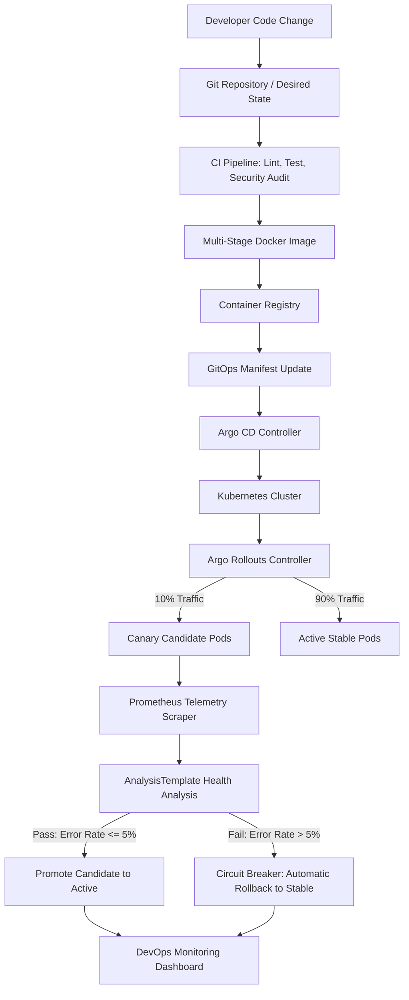

# CLOUD-05: GitOps-Based Progressive Delivery with Automated Health Gating and Rollback

**Final-Year CSE Capstone Project**  
**Technology Stack:** Node.js, Express.js, Prometheus, Docker, Kubernetes, Argo CD, Argo Rollouts, HTML5/CSS/JavaScript  
**Runtime Endpoint:** `http://localhost:5005`  
**Telemetry Endpoint:** `http://localhost:5005/metrics`  

---

## 1. Project Overview & Architecture

Traditional Continuous Integration and Continuous Delivery (CI/CD) pipelines frequently deploy software candidates directly into production. When a release contains subtle, semantic, or latent defects, conventional deployment patterns expose 100% of users to disruption before problems are detected.

**CLOUD-05** implements an end-to-end cloud-native GitOps architecture that eliminates this vulnerability using:
1. **Git as Single Source of Truth:** Desired infrastructure and application versions are managed declaratively in Git.
2. **GitOps Reconciliation:** Argo CD synchronizes desired states directly into Kubernetes.
3. **Progressive Delivery (Canary Deployments):** Argo Rollouts gradually increases candidate traffic exposure (10% &rarr; 25% &rarr; 50% &rarr; 100%).
4. **Automated Health Analysis:** Real-time Prometheus metrics (`cloud05_http_requests_total`, error rates, latencies) continuously evaluate candidate health.
5. **Circuit-Breaker Automatic Rollback:** If metrics breach predefined safety thresholds, the rollout aborts immediately and restores 100% traffic to the previously healthy release.

### Architecture Diagram



---

## 2. Directory Structure

```
cloud05-capstone/
├── backend/
│   ├── src/
│   │   ├── app.js                   # Express application setup, routes & middleware
│   │   ├── server.js                # Server entrypoint listening on port 5005
│   │   ├── config/
│   │   │   └── environment.js       # Centralized typed configuration & paths
│   │   ├── middleware/
│   │   │   ├── error-handler.js     # Graceful error handler (no secret leakage)
│   │   │   └── metrics.middleware.js # Prometheus HTTP duration & counter collector
│   │   ├── routes/
│   │   │   ├── health.routes.js     # /health, /ready, /version
│   │   │   ├── status.routes.js     # /api/status telemetry state
│   │   │   ├── config.routes.js     # /api/config disk file state
│   │   │   ├── events.routes.js     # /api/events chronological audit stream
│   │   │   ├── deployment.routes.js # /api/deploy/* triggers & reset
│   │   │   ├── metrics.routes.js    # /metrics Prometheus endpoint
│   │   │   └── demo.routes.js       # /api/demo/* realistic business operations
│   │   ├── services/
│   │   │   ├── state.service.js     # Thread-safe in-memory progressive state machine
│   │   │   ├── rollout.service.js   # Canary lifecycle & circuit-breaker rollback engine
│   │   │   ├── config.service.js    # Strict JSON schema validator for release_config.json
│   │   │   ├── event.service.js     # Chronological audit stream ring buffer
│   │   │   ├── metrics.service.js   # prom-client Prometheus metrics definitions
│   │   │   └── k8s.service.js       # Cluster & Argo Rollouts connectivity detector
│   │   └── utils/
│   │       └── logger.js            # Structured JSON logger
│   ├── tests/
│   │   ├── health.test.js           # Tests for /health, /ready, /version, /metrics
│   │   ├── config.test.js           # Tests for schema validation & active preservation
│   │   ├── rollout.test.js          # Tests for promotion, rollback & boundary cases
│   │   └── demo.test.js             # Tests for demo business operations
│   ├── Dockerfile                   # Multi-stage non-root container configuration
│   ├── release_config.json          # Live evaluated release configuration file
│   └── package.json                 # Node.js backend dependencies & scripts
├── frontend/
│   ├── index.html                   # Cloud-native DevOps monitoring dashboard
│   ├── css/
│   │   └── style.css                # Dark theme, badges, traffic bars, pipeline tracker
│   └── js/
│       └── app.js                   # Reactive polling engine (1s interval) & event rendering
├── k8s/
│   ├── namespace.yaml               # cloud05-app namespace
│   ├── configmap.yaml               # Application environment configuration
│   ├── secrets.yaml                 # Sensitive secret references
│   ├── services.yaml                # Active and Preview Kubernetes services
│   ├── analysis-template.yaml       # Argo Rollouts Prometheus health analysis queries
│   ├── rollout.yaml                 # Argo Rollouts progressive canary CRD
│   ├── argocd-application.yaml      # Argo CD GitOps Application manifest
│   └── kustomization.yaml           # Kustomize manifest bundle
├── monitoring/
│   ├── prometheus.yml               # Prometheus scraper configuration
│   └── grafana-dashboard.json       # Grafana telemetry dashboard definition
├── experiments/
│   └── run_experiments.js          # Controlled academic benchmark runner
├── evidence/
│   ├── phase1/                      # Baseline audit reports
│   └── final_review/                # Research paper, raw data & verification matrix
├── .github/workflows/
│   └── ci-cd.yml                    # Automated GitHub Actions pipeline
├── test_e2e.js                      # Root one-command JavaScript E2E test suite
├── package.json                     # Root project package definition
└── README.md                        # Documentation
```

---

## 3. How to Run Locally

### Prerequisites
- Node.js (v18.0.0 or higher)
- npm (v9.0.0 or higher)
- A modern web browser

### Start the Application
From the project root:
```bash
# 1. Install dependencies
npm --prefix backend install

# 2. Start Node.js backend
npm start
```
The server starts at: **`http://localhost:5005`**  
Open your browser to view the interactive DevOps dashboard!

---

## 4. Running Automated Tests

### Unit & Integration Test Suite (Vitest & Supertest)
```bash
npm test
```
*Executes all 24 automated unit and integration tests across health, configuration validation, canary promotion, circuit breaker rollback, and business operations.*

### One-Command End-to-End Test Suite (Live Server)
```bash
node test_e2e.js
```
*Validates all 12 end-to-end scenarios against a running server with color-coded PASS/FAIL reporting.*

---

## 5. Live Demonstration Guide for Reviewers

### Scenario 1: Healthy Release Promotion Demonstration
1. Open `backend/release_config.json` and set:
   ```json
   {
     "version": "v4.0",
     "message": "Healthy release test",
     "error_rate": 0,
     "threshold": 5
   }
   ```
2. Open the dashboard at `http://localhost:5005`.
3. Notice the card displays `Projected Outcome: PASS (Promote)`.
4. Click **Deploy Current Configuration** (or **Deploy Healthy Release**).
5. Watch the progressive lifecycle:
   - Pipeline visualizer lights up Step 5 (`10% Canary`).
   - Ramps to Step 6 (`50% Canary`) while Prometheus probes evaluate health (`0% <= 5%`).
   - Candidate `v4.0` is promoted to **Active Release**.
   - Traffic returns to 100% active; previous stable `v1.0` is preserved for rollbacks.

### Scenario 2: Faulty Release & Automatic Rollback Demonstration
1. Open `backend/release_config.json` and set:
   ```json
   {
     "version": "v5.0",
     "message": "Faulty release test",
     "error_rate": 18,
     "threshold": 5
   }
   ```
2. On the dashboard, notice `Projected Outcome: FAIL (Rollback)`.
3. Click **Deploy Current Configuration** (or **Deploy Faulty Release**).
4. Watch the automatic rollback lifecycle:
   - Canary initiates at 10%, ramping to 50%.
   - Health analysis detects violation: error rate (18%) exceeds threshold (5%).
   - Circuit breaker trips: `/health` returns **HTTP 503**, dashboard turns RED.
   - **Automated Rollback triggers immediately**: candidate `v5.0` is discarded.
   - Previous stable release (`v4.0`) is restored to 100% active traffic.
   - Red **Automated Rollback Event Detected** alert card appears with timestamp and failure reason.
   - Application health returns to **HEALTHY** (HTTP 200).

### Scenario 3: Invalid Configuration Rejection
1. Set `error_rate: -10` or remove the `version` field in `backend/release_config.json`.
2. Notice the badge shows `Invalid Config`.
3. Click **Deploy Current Configuration**.
4. The deployment is rejected with **HTTP 400**. The active version remains 100% untouched.

---

## 6. API Reference

| Method | Endpoint | Description |
| :--- | :--- | :--- |
| `GET` | `/` | DevOps Monitoring Dashboard UI |
| `GET` | `/health` | Application liveness probe (200 = HEALTHY, 503 = UNHEALTHY) |
| `GET` | `/ready` | Application readiness probe (200 = READY, 503 = NOT_READY) |
| `GET` | `/version` | Service identifier, active version, candidate version, environment |
| `GET` | `/metrics` | Prometheus telemetry metrics (`prom-client`) |
| `GET` | `/api/status` | Real-time JSON telemetry (active, candidate, split, rollback metadata) |
| `GET` | `/api/config` | Current `release_config.json` state & validation status |
| `GET` | `/api/events` | Chronological audit log of pipeline events |
| `GET` | `/api/demo/products` | Sample business microservice catalog operation |
| `POST` | `/api/demo/orders` | Sample business transaction processing operation |
| `POST` | `/api/deploy/healthy` | Trigger preset healthy candidate rollout (`v2.0` &rarr; Promoted) |
| `POST` | `/api/deploy/faulty` | Trigger preset faulty candidate rollout (`v3.0` &rarr; Auto-Rollback) |
| `POST` | `/api/deploy/current-config`| Live disk file deployment with validation & health gating |
| `POST` | `/api/reset` | Operator state reset to initial `v1.0` baseline |
