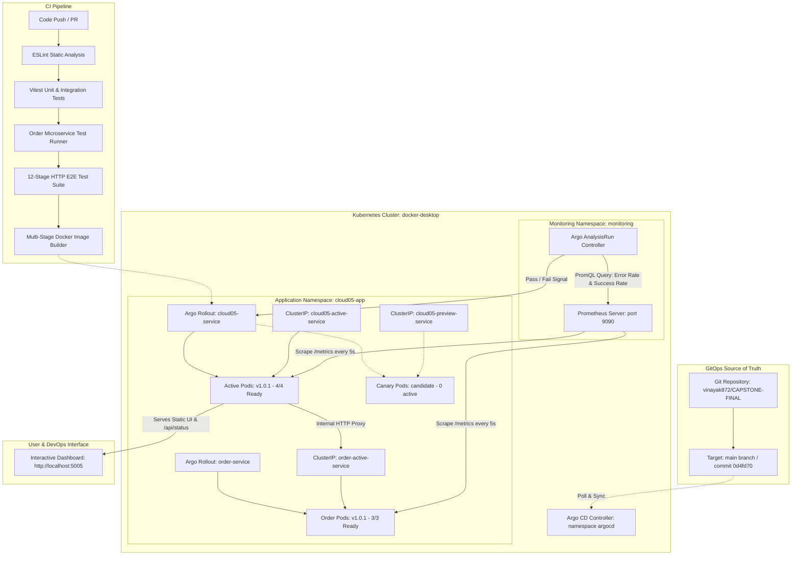
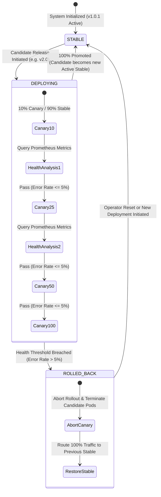

# System Architecture & Component Specification

## 1. Architectural Philosophy

Modern continuous deployment patterns expose systems to production-grade failure when code passes synthetic tests but contains subtle, semantic, or environmental flaws. Traditional deployment strategies (such as Kubernetes native rolling updates or recreate strategies) lack:
- Fine-grained request- or replica-level traffic shifting.
- Integrated telemetry evaluation before full traffic cutover.
- Automated circuit-breaker rollbacks based on dynamic health breaches.

**CLOUD-05** resolves this with an end-to-end cloud-native GitOps architecture featuring:
1. **Declarative GitOps:** Git is the single source of truth for all infrastructure, configuration, and image tags.
2. **Automated Reconciliation:** Argo CD continuously compares desired Git state against the live Kubernetes cluster.
3. **Progressive Delivery (Canary Deployments):** Argo Rollouts partitions traffic dynamically (10% &rarr; 25% &rarr; 50% &rarr; 100%).
4. **Automated Metric Gating:** Prometheus continuously scrapes HTTP error rates and latency, and Argo Rollouts `AnalysisRuns` evaluate candidate health against strict thresholds.
5. **Instantaneous Rollback:** If metrics breach predefined safety thresholds (e.g. error rate > 5%), the rollout aborts immediately and routes 100% of traffic back to the stable release.

---

## 2. System Architecture Diagram

---

## 3. Core Subsystems

### 3.1 Progressive Delivery Gateway (`backend/src/`)
Built with **Node.js 20 and Express.js**, the Gateway acts as both the user-facing web server, API gateway, and orchestration engine:
- **`server.js`:** Process entry point, starts HTTP server on port 5005, initializes cluster connectivity poller.
- **`app.js`:** Express middleware configuration (security headers, CORS, rate limiting, Prometheus metrics middleware, JSON parsing, and graceful error handlers).
- **`services/k8s.service.js`:** Authoritative cluster telemetry bridge. Detects whether running inside a Kubernetes pod (via `/var/run/secrets/kubernetes.io/serviceaccount/token` and `KUBERNETES_SERVICE_HOST`) or on the local host (via `kubectl`). Queries Rollouts, ReplicaSets, Argo CD applications, and AnalysisRuns.
- **`services/state.service.js`:** In-memory progressive delivery state machine tracking active version, candidate version, traffic splits, and deployment lifecycle.
- **`services/metrics.service.js`:** Uses `prom-client` to expose production metrics on `/metrics`.
- **`services/event.service.js`:** High-resolution chronological audit event journal recording all system actions.

### 3.2 Independent Order Microservice (`services/order-service/`)
A dedicated, independently deployable microservice running on port 5006:
- Implements order creation (`POST /orders`) with strict payload validation.
- Implements product catalog retrieval (`GET /products`).
- Features a separate health probe (`GET /health`) and Prometheus exporter (`GET /metrics`).
- Deployed in Kubernetes via its own dedicated Rollout (`k8s/order-service-rollout.yaml`) and ClusterIP services (`k8s/order-service-services.yaml`).

### 3.3 Frontend Monitoring Dashboard (`frontend/`)
A responsive, dependency-free dashboard built with HTML5, CSS3, and JavaScript:
- **Execution Mode Badge:** Dynamically reflects `Kubernetes Mode` (green) or `Simulation Mode` (cyan).
- **Cluster Connectivity Grid:** Real-time health indicators for Kubernetes API, Argo Rollouts controller, Argo CD application, and Prometheus server.
- **Microservice Mesh Status:** Live visualizer of the API Gateway and Order Microservice pod replica distribution (e.g. `4 Ready / 4 Total (4 Stable, 0 Canary)`).
- **Argo CD Status Banner:** Displays Git repository URL, target branch, reconciled commit SHA, sync status, and health status.
- **7-Stage Pipeline Visualizer:** Interactive display of deployment stages (Commit &rarr; CI &rarr; Image &rarr; GitOps Sync &rarr; Canary &rarr; Health Analysis &rarr; Active Stable).
- **Research Benchmark Cards:** Displays verifiable data from `experiment_raw_data.json` with clear academic simulation disclosures.

---

## 4. State Machine Transitions

