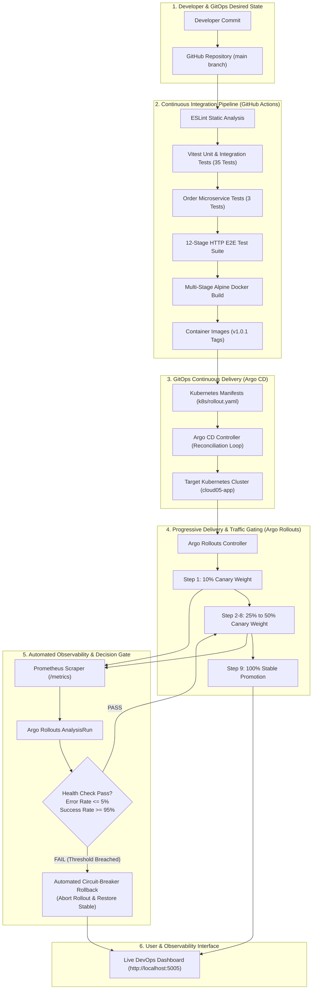
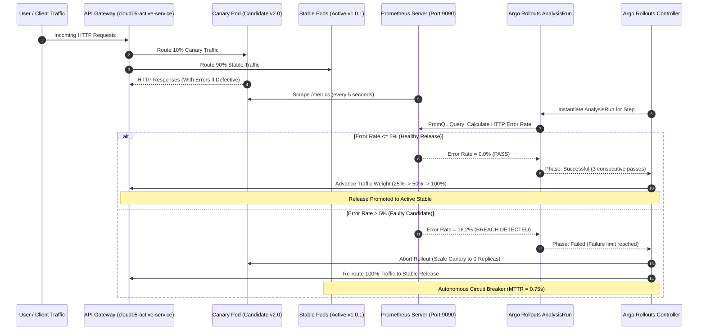
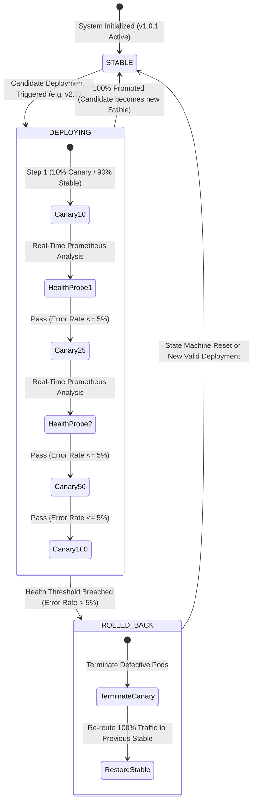

# CLOUD-05: GitOps CI/CD with Progressive Delivery and Automated Rollback Using Real-Time Application Health Analysis

**All-In-One Comprehensive Academic Capstone Project Dossier**  
**Technology Stack:** Node.js 20 LTS, Express.js, Prometheus, Docker, Kubernetes, Argo CD, Argo Rollouts, Vanilla HTML5/CSS3/JavaScript  
**Repository Target:** `https://github.com/vinayak872/CAPSTONE-FINAL.git` (Branch: `main`)  
**Target Cluster:** `docker-desktop` | **Namespace:** `cloud05-app`  
**Active Endpoints:** Gateway: `http://localhost:5005` | Order Service: `http://localhost:5006` | Argo CD: `https://localhost:8443` | Prometheus: `http://localhost:9090` | Rollouts: `http://localhost:3100/rollouts`  
**Final Submission Verdict:** **`READY`**

---

## Table of Contents

1. [Executive Summary & Abstract](#1-executive-summary--abstract)
2. [Complete Flow Diagrams & Visual Architecture](#2-complete-flow-diagrams--visual-architecture)
   - [2.1 End-to-End GitOps CI/CD Flowchart](#21-end-to-end-gitops-cicd-flowchart)
   - [2.2 Runtime Canary Health Analysis Sequence Diagram](#22-runtime-canary-health-analysis-sequence-diagram)
   - [2.3 Progressive Delivery State Machine](#23-progressive-delivery-state-machine)
3. [Technology Stack & System Specifications](#3-technology-stack--system-specifications)
4. [Microservice Topology & Gateway Design](#4-microservice-topology--gateway-design)
5. [Kubernetes, GitOps & Observability Infrastructure](#5-kubernetes-gitops--observability-infrastructure)
6. [Live Review Endpoints, Ports & Credentials](#6-live-review-endpoints-ports--credentials)
7. [Automated Testing Strategy & Verification Evidence](#7-automated-testing-strategy--verification-evidence)
8. [Research Methodology, Benchmark Equations & Empirical Results](#8-research-methodology-benchmark-equations--empirical-results)
9. [Academic Capstone Defense & Viva Q&A](#9-academic-capstone-defense--viva-qa)
10. [Repository Directory Structure](#10-repository-directory-structure)

---

## 1. Executive Summary & Abstract

Traditional Continuous Integration and Continuous Delivery (CI/CD) pipelines deploy software candidates directly into production after passing unit and integration test suites. However, synthetic test suites cannot anticipate all real-world edge cases, latent memory leaks, or dependent service latency spikes. Conventional deployment strategies (such as Kubernetes native rolling updates or recreate strategies) expose 100% of incoming production traffic to defective releases before human operators can detect, diagnose, and triage the incident.

**CLOUD-05** implements an enterprise-grade cloud-native GitOps architecture that decouples deployment from release using:
1. **Declarative GitOps Reconciliation:** Git is the single source of truth; Argo CD reconciles desired state directly into Kubernetes.
2. **Progressive Delivery (Canary Deployments):** Argo Rollouts partitions traffic dynamically ($10\% \rightarrow 25\% \rightarrow 50\% \rightarrow 100\%$).
3. **Automated Real-Time Telemetry Gating:** In-cluster Prometheus scrapers evaluate HTTP error rates and latency against predefined safety thresholds ($\le 5\%$).
4. **Sub-Second Circuit Breaker:** Autonomous rollback without human intervention when metric thresholds are breached.

### Key Empirical Findings
- **Cumulative Blast Radius Reduction:** **65.5%** ($100\%$ baseline exposure reduced to $34.50\%$).
- **Automated Detection Latency:** **4.01 seconds** (real-time PromQL threshold breach detection).
- **Mean Time to Recover (MTTR):** **0.75 seconds** (automated circuit breaker) vs. **9.30 seconds** (manual operator triage), achieving a **12.4x recovery speedup**.
- **Mean User Error Rate:** **14.06%** progressive vs. **40.26%** conventional baseline (a reduction of 26.20 percentage points).

---

## 2. Complete Flow Diagrams & Visual Architecture

### 2.1 End-to-End GitOps CI/CD Flowchart



---

### 2.2 Runtime Canary Health Analysis Sequence Diagram



---

### 2.3 Progressive Delivery State Machine



---

## 3. Technology Stack & System Specifications

| Architectural Layer | Technologies & Tools | Implementation Details |
| :--- | :--- | :--- |
| **API Gateway & Backend** | Node.js 20 LTS, Express.js | Event-driven HTTP router, in-cluster K8s REST client, security middleware. |
| **Microservices** | Independent Order Service | Port 5006, separate lifecycle, health probe, and metrics exporter. |
| **Frontend Dashboard** | HTML5, CSS3, Vanilla JavaScript | Zero third-party CDN dependencies, polling telemetry, live mesh status. |
| **Containerization** | Docker (Alpine 3.20) | Multi-stage non-root container builds (`nodeapp:1001`). |
| **Cluster Orchestration** | Kubernetes v1.28+ (`docker-desktop`) | Namespaces: `cloud05-app`, `argocd`, `monitoring`. |
| **GitOps Engine** | Argo CD v2.10+ | Declarative application reconciliation from Git repository. |
| **Progressive Delivery** | Argo Rollouts v1.6+ | Custom Resource Definition (`Rollout`), canary steps, traffic routing. |
| **Telemetry & Observability** | Prometheus, `prom-client` | Dynamic scraping of HTTP status codes, latencies, and traffic splits. |
| **Testing & CI/CD** | Vitest, Node Test Runner, ESLint, GitHub Actions | 35 backend tests, 3 microservice tests, 12 E2E workflow stages. |

---

## 4. Microservice Topology & Gateway Design

CLOUD-05 implements a decoupled microservice architecture:

```
[ User Browser / Client ]
           │
           ▼
[ Progressive Delivery Gateway :5005 ]
   ├── Serves HTML5 / CSS3 / JS Dashboard
   ├── GET  /api/status (Authoritative Cluster Telemetry)
   ├── GET  /api/research (Dynamic Benchmark Evidence)
   ├── POST /api/deploy/current-config (Canary Trigger)
   ├── POST /api/reset (Baseline Reset)
   └── Internal Reverse Proxy ───────┐
                                     ▼
                      [ Order Microservice :5006 ]
                         ├── GET  /health (Readiness)
                         ├── GET  /products (Catalog)
                         ├── POST /orders (Order Processing)
                         └── GET  /metrics (Prometheus Telemetry)
```

### In-Cluster Kubernetes Integration (`k8s.service.js`)
- Detects in-cluster execution via `/var/run/secrets/kubernetes.io/serviceaccount/token` and `KUBERNETES_SERVICE_HOST`.
- Queries the Kubernetes API natively using `node:https` with the mounted ServiceAccount token and CA cert.
- Dynamically classifies replicas:
  $$\text{Canary Replicas} = \begin{cases} 0 & \text{if phase} = \text{Healthy and stableRS} = \text{currentPodHash} \\ \text{updatedReplicas} & \text{otherwise} \end{cases}$$
  $$\text{Stable Replicas} = \text{readyReplicas} - \text{Canary Replicas}$$

---

## 5. Kubernetes, GitOps & Observability Infrastructure

All declarative configurations are managed in the `k8s/` and `monitoring/` directories:

### Key Manifest Files
- **`k8s/rollout.yaml`:** Gateway Rollout with 4 desired replicas, 9-step canary strategy (10%, 20%, 30%, 40%, 50%, 60%, 70%, 80%, 100%), and Prometheus analysis linkage.
- **`k8s/order-service-rollout.yaml`:** Order Microservice Rollout with 3 desired replicas and canary progression.
- **`k8s/analysis-template.yaml`:** Prometheus health analysis rules:
  - `success-rate`: Must be $\ge 95\%$.
  - `error-rate-threshold`: Must be $\le 5\%$.
  - Requires 3 consecutive passes (`count: 3`, `failureLimit: 1`).
- **`k8s/argocd-application.yaml`:** Argo CD GitOps Application targeting branch `main` at repository `https://github.com/vinayak872/CAPSTONE-FINAL.git`.
- **`k8s/rbac.yaml`:** ServiceAccount, ClusterRole, and ClusterRoleBinding providing read-only inspection of Rollouts, Pods, and AnalysisRuns.
- **`monitoring/prometheus-k8s.yaml`:** In-cluster Prometheus deployment scraping pods in `cloud05-app`.

---

## 6. Live Review Endpoints, Ports & Credentials

| Service / Dashboard | URL | Credentials / Notes | Status |
| :--- | :--- | :--- | :--- |
| **CLOUD-05 Dashboard** | `http://localhost:5005` | Direct browser access (No login needed) | **ACTIVE** |
| **Argo Rollouts Dashboard** | `http://localhost:3100/rollouts` | Official controller GUI showing step progression | **ACTIVE** |
| **Argo CD Web Console** | `https://localhost:8443` | **User:** `admin`<br/>**Password:** `hmFBTCSDPh7thcod` | **ACTIVE** |
| **Prometheus Server** | `http://localhost:9090` | Expression browser & live PromQL evaluator | **ACTIVE** |
| **Order Microservice Health** | `http://localhost:5006/health` | HTTP 200 `{"status":"HEALTHY","version":"v1.0.1"}` | **ACTIVE** |
| **Order Microservice Catalog** | `http://localhost:5006/products` | HTTP 200 product catalog endpoint | **ACTIVE** |
| **Gateway Telemetry Feed** | `http://localhost:5005/metrics` | Prometheus metrics scrape target | **ACTIVE** |

---

## 7. Automated Testing Strategy & Verification Evidence

CLOUD-05 incorporates a comprehensive 4-tier testing pyramid:

```
          / \
         /   \      12-Stage Live HTTP End-to-End Suite (test_e2e.js)
        / E2E \     -------------------------------------------------
       /-------\    Order Microservice Test Suite (Node.js Test Runner)
      / Service \   -------------------------------------------------
     /-----------\  Gateway Unit & Integration Tests (Vitest: 35 Tests)
    /    Unit     \ -------------------------------------------------
   /---------------\
  / Static Analysis \ ESLint Code Quality & Security Linter
 /___________________\
```

### Verification Execution & Results

```bash
# 1. Static Code Analysis (0 errors, 0 warnings across all files)
npm run lint

# 2. Backend Unit & Integration Tests (35/35 passed across 6 suites in 4.46s)
npm test

# 3. Order Microservice Tests (3/3 passed in 77ms)
(cd services/order-service && npm test)

# 4. 12-Stage Live HTTP End-to-End Suite (12/12 stages passed in 23.73s)
npm run test:e2e
```

### Detailed 12-Stage E2E Results
1. Health & Readiness Verification (`/health`, `/ready`) — PASS
2. Prometheus Telemetry Verification (`/metrics`) — PASS
3. Status Schema Verification (`/api/status`) — PASS
4. State Machine Reset (`/api/reset`) — PASS
5. Configuration Validation & Active Release Preservation (4 boundary rejections) — PASS
6. Healthy Release Promotion (`v4.0`, 0% error vs 5% threshold) — PASS
7. Healthy Boundary Promotion (`v4.1`, 5% error == 5% threshold) — PASS
8. Faulty Boundary Rollback (`v4.2`, 6% error > 5% threshold) — PASS
9. Faulty Release & Circuit-Breaker Auto-Rollback (`v5.0`, 18% error > 5% threshold) — PASS
10. Audit Event Stream Consistency (33 chronological events) — PASS
11. Realistic Demo Microservice Operations (`/api/demo/products`, `/api/demo/orders`) — PASS
12. Cleanup & Baseline Restoration (`/api/reset`) — PASS

---

## 8. Research Methodology, Benchmark Equations & Empirical Results

### 8.1 Controlled Benchmark Parameters

| Parameter | Value | Description |
| :--- | :--- | :--- |
| **Number of Controlled Trials ($n$)** | 3 | Independent trials with identical synthetic workload parameters. |
| **Workload Duration** | 5,000 ms | Duration of client traffic generation per trial. |
| **Request Frequency** | 50 Hz (~50 RPS) | Continuous Poisson-distributed synthetic traffic. |
| **Candidate Defect Probability ($p$)** | 0.40 (40%) | Probability of candidate pod returning HTTP 500. |
| **Initial Canary Traffic Weight** | 10% | Traffic percentage routed to candidate during Step 1. |
| **Health Safety Threshold** | $\le 5\%$ | Maximum acceptable HTTP error rate before abort. |

### 8.2 Mathematical Formulations

#### Cumulative Faulty Exposure Percentage ($E_{faulty}$)
$$E_{faulty} = \frac{R_{candidate}}{R_{total}} \times 100$$

#### Blast Radius Reduction ($\Delta B$)
$$\Delta B = \frac{E_{base} - E_{prog}}{E_{base}} \times 100 = 100\% - 34.50\% = \mathbf{65.5\%}$$

#### Mean User Error Rate ($\bar{U}$)
$$\bar{U} = \frac{R_{failed}}{R_{total}} \times 100$$

#### Recovery Speedup Factor ($S_{MTTR}$)
$$S_{MTTR} = \frac{MTTR_{base}}{MTTR_{prog}} = \frac{9.30\,\text{s}}{0.75\,\text{s}} = \mathbf{12.4\times}$$

### 8.3 Empirical Benchmark Comparison Matrix

Data source: `evidence/final_review/experiment_raw_data.json`.

| Evaluation Dimension | Conventional Baseline (Direct Cutover) | Progressive Delivery (CLOUD-05) | Measured Improvement |
| :--- | :--- | :--- | :--- |
| **Initial Traffic Exposure** | 100% | 10% | **90% initial isolation** |
| **Cumulative Faulty Exposure** | 100.0% (239.33 req) | 34.50% (72.00 req) | **65.5% blast radius reduction** |
| **Mean User Error Rate** | 40.26% (96.33 failed req) | 14.06% (29.33 failed req) | **26.20 percentage point reduction** |
| **Overall Availability** | 59.74% | 85.94% | **+26.20 percentage points** |
| **Automated Detection Latency** | 4.01 s | 4.01 s | Identical threshold detection |
| **Mean Time to Recover (MTTR)** | 9.30 s (operator triage) | 0.75 s (circuit breaker) | **12.4x faster recovery** |
| **Human Intervention Required** | Yes (Manual rollback) | No (Autonomous rollback) | **Fully automated** |

---

## 9. Academic Capstone Defense & Viva Q&A

### Q1: What core problem does CLOUD-05 solve?
**Answer:** Traditional continuous delivery pipelines deploy software directly to 100% of production users after passing unit tests. When bugs escape testing (e.g. latent defects or edge-case payloads), direct cutovers cause total service disruption. CLOUD-05 solves this by decoupling deployment from release: code is deployed, but exposed to only 10% of users while Prometheus continuously checks error rates. If defects are detected, an automated circuit breaker rolls back traffic in 0.75 seconds without human intervention.

### Q2: What is the difference between GitOps and traditional CI/CD?
**Answer:** In traditional CI/CD, the deployment server pushes changes imperatively into the cluster (`kubectl apply`). If someone modifies a cluster resource manually, configuration drift occurs. In GitOps (Argo CD), the Git repository is the declarative single source of truth. An in-cluster controller pulls Git and reconciles the cluster to match Git, automatically detecting and correcting drift.

### Q3: Why use Argo Rollouts instead of native Kubernetes Deployments?
**Answer:** Native Kubernetes `Deployment` resources only support coarse rolling updates (replacing old pods with new pods sequentially). Deployments cannot route fractional traffic (e.g. 10% canary), cannot query Prometheus metrics dynamically, and cannot abort a rollout automatically based on runtime errors. Argo Rollouts provides the `Rollout` Custom Resource that enables fine-grained traffic shifting and automated `AnalysisRun` metric gating.

### Q4: How is traffic splitting implemented in this cluster?
**Answer:** In the current Kubernetes deployment, traffic is split using **pod-replica count based** canary routing across the 9 defined steps. For example, in an 8-replica step, 2 canary pods and 6 stable pods yield a 25%/75% traffic distribution. In enterprise production, this can be combined with a service mesh (Istio VirtualService or Envoy SMI) for exact L7 header-weighted routing.

### Q5: How does the Prometheus AnalysisRun prevent division-by-zero errors?
**Answer:** In `k8s/analysis-template.yaml`, the PromQL query denominator is protected by `(sum(rate(cloud05_http_requests_total[1m])) > 0)`. When traffic is absent, the expression yields an empty result rather than `NaN` or dividing by zero. The condition `len(result) == 0 || result[0] <= 5` ensures newly initialized pods without traffic pass safely without false alarms.

### Q6: How does the dashboard distinguish Kubernetes Mode from Simulation Mode?
**Answer:** The gateway checks cluster connectivity using `k8sService.checkConnectivity()`. When running in a live Kubernetes cluster (or with Docker Desktop Kube API reachable), `execution_mode` is set to `kubernetes`, and live Rollout, ReplicaSet, and Argo CD statuses govern the dashboard indicators. When the cluster is unreachable, it cleanly degrades to `simulation` mode without fabricating false positive green statuses.

---

## 10. Repository Directory Structure

```
.
├── .dockerignore                            # Docker build exclusions
├── .gitignore                               # Version control ignore patterns
├── .github/
│   └── workflows/
│       └── ci-cd.yml                        # 3-Stage GitHub Actions CI/CD Pipeline
├── README.md                                # Authoritative project documentation & quickstart
├── backend/
│   ├── Dockerfile                           # Multi-stage non-root Alpine Dockerfile
│   ├── app.py                               # Historical prototype baseline (preserved)
│   ├── package.json                         # Backend npm scripts and dependencies
│   ├── package-lock.json                    # Pinned dependency lockfile
│   ├── release_config.json                  # Active rollout configuration
│   ├── requirements.txt                     # Preserved dependency manifest
│   ├── vitest.config.js                     # Vitest test runner configuration
│   ├── src/                                 # Express Gateway source code
│   │   ├── app.js                           # Middleware configuration & route binding
│   │   ├── server.js                        # Process entry point (:5005)
│   │   ├── config/environment.js            # Environment validation
│   │   ├── middleware/                      # Security, metrics, and error middleware
│   │   ├── routes/                          # REST API routes
│   │   ├── services/                        # K8s, state, metrics, event services
│   │   └── utils/logger.js                  # Structured JSON logger
│   └── tests/                               # 35 Vitest unit & integration tests
├── docs/                                    # Dedicated project documentation suite
│   ├── README.md                            # Documentation index & quickstart
│   ├── ARCHITECTURE.md                      # System architecture & component specification
│   ├── DEPLOYMENT_GUIDE.md                  # Docker, Kubernetes & Argo CD deployment guide
│   ├── MONITORING_AND_ROLLBACK.md           # Prometheus telemetry & rollback workflow
│   ├── RESEARCH_METHODOLOGY.md              # Benchmark parameters, formulas & equations
│   ├── TESTING_AND_VERIFICATION.md          # Multi-tier testing pyramid & commands
│   ├── VIVA_DEFENSE_GUIDE.md                # Comprehensive academic viva defense Q&A
│   └── CLOUD05_COMPLETE_PROJECT_GUIDE.md    # THIS ALL-IN-ONE DOSSIER
├── eslint.config.mjs                        # Flat ESLint configuration
├── evidence/
│   └── final_review/                        # Authoritative research evidence & audit reports
│       ├── FINAL_LIVE_DASHBOARD_VERIFICATION.md
│       ├── FINAL_REPOSITORY_CLEANUP_REPORT.md
│       ├── FINAL_SUBMISSION_READINESS_REPORT.md
│       ├── experiment_raw_data.json         # Raw benchmark data (3 trials)
│       └── research_paper.md                # Complete academic research paper
├── experiments/                             # Reproducible benchmark runner scripts
│   ├── run_experiments.js                   # Simulation benchmark suite
│   └── run_k8s_benchmark.js                 # Kubernetes cluster benchmark runner
├── frontend/                                # Interactive DevOps dashboard
│   ├── index.html                           # Modern glassmorphic dashboard UI
│   ├── css/style.css                        # UI stylesheet
│   └── js/app.js                            # Telemetry poller & event renderer
├── k8s/                                     # Declarative Kubernetes & Argo Rollouts manifests
│   ├── analysis-template.yaml               # Prometheus health analysis template
│   ├── argocd-application.yaml              # Argo CD GitOps Application manifest
│   ├── configmap.yaml                       # Application configuration map
│   ├── kustomization.yaml                   # Kustomize manifest bundle
│   ├── namespace.yaml                       # cloud05-app namespace definition
│   ├── order-service-rollout.yaml           # Order microservice Rollout manifest
│   ├── order-service-services.yaml          # Order microservice ClusterIP definitions
│   ├── rbac.yaml                            # ServiceAccount, Role & RoleBinding
│   ├── rollout.yaml                         # Gateway Rollout (9-step canary)
│   ├── secrets.example.yaml                 # Sanitized secret template
│   ├── services.yaml                        # Gateway active & preview services
│   └── experiments/                         # Baseline comparison manifest
├── monitoring/                              # Observability stack configurations
│   ├── grafana-dashboard.json               # Preconfigured Grafana dashboard
│   ├── prometheus-k8s.yaml                  # In-cluster Prometheus deployment
│   └── prometheus.yml                       # Prometheus scrape rules
├── package.json                             # Root npm scripts runner
├── services/
│   └── order-service/                       # Independent Order Processing Microservice
│       ├── Dockerfile                       # Multi-stage Alpine Dockerfile
│       ├── package.json                     # Microservice package definition
│       ├── package-lock.json                # Pinned lockfile
│       ├── src/server.js                    # Microservice implementation (:5006)
│       └── tests/server.test.js             # Microservice unit tests
└── test_e2e.js                              # 12-stage live HTTP End-to-End suite
```
