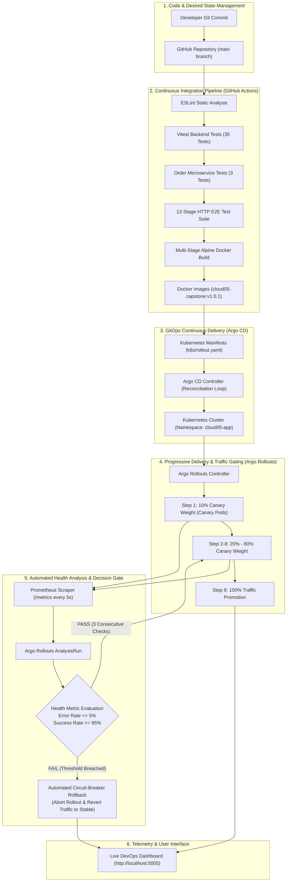
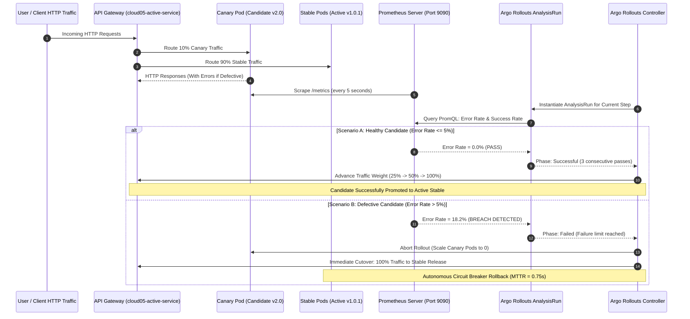
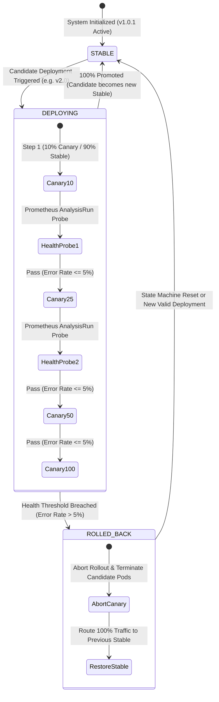
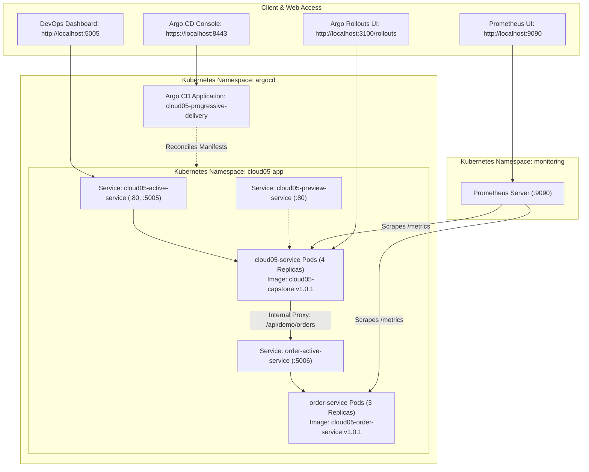

# CLOUD-05: Complete Architectural & Procedural Flow Diagrams

This document contains all formal flowcharts, sequence diagrams, state machines, and microservice topology diagrams for **CLOUD-05: GitOps CI/CD with Progressive Delivery and Automated Rollback Using Real-Time Application Health Analysis**.

---

## 1. End-to-End GitOps CI/CD & Delivery Flowchart

This flowchart maps the entire lifecycle of a code change: from developer commit in GitHub, through the CI pipeline and Docker build, into Argo CD GitOps reconciliation, Argo Rollouts progressive canary steps, and Prometheus telemetry evaluation to either stable promotion or automated rollback.

---

## 2. Runtime Telemetry Feedback & Analysis Sequence Diagram

This sequence diagram depicts the exact millisecond-level interaction between client requests, pods, Prometheus scraping, AnalysisRuns, and the Rollouts controller during healthy vs. faulty deployments.

---

## 3. Progressive Delivery State Machine

This state machine visualizes the life cycle and status transitions of deployments within both the Kubernetes cluster and the Gateway engine.

---

## 4. Microservice Mesh & Cluster Network Topology

This diagram details the networking boundaries, service endpoints, port allocations, and inter-service HTTP proxies across the `cloud05-app`, `monitoring`, and `argocd` Kubernetes namespaces.

---

## 5. Step-by-Step Flow Description (Review Walkthrough)

### Step 1: Desired State Change
- A developer pushes code to `main` branch on GitHub repository `https://github.com/vinayak872/CAPSTONE-FINAL.git`.
- GitHub Actions CI executes ESLint, 35 Vitest backend tests, 3 order microservice tests, and the 12-stage E2E suite.
- If all tests pass, Docker Buildx compiles the multi-stage Alpine image tagged with the commit SHA or release version.

### Step 2: GitOps Reconciliation
- Argo CD detects the Git commit and reconciles the target Kubernetes cluster (`cloud05-app`).
- The `Rollout` manifest updates the container image reference to candidate `v2.0`.

### Step 3: Canary Traffic Gating
- The Argo Rollouts controller starts with **Step 1** at **10% canary traffic weight**.
- 1 replica runs the candidate image, while 3 replicas continue running the active stable release.
- Client requests hitting `cloud05-active-service` are distributed across pods via Kubernetes service endpoints.

### Step 4: Real-Time Prometheus Health Gating
- Candidate pods emit HTTP request counters and latencies on `/metrics`.
- In-cluster Prometheus scrapes these metrics every 5 seconds.
- An `AnalysisRun` instantiates and executes PromQL queries:
  - Error rate must be $\le 5\%$.
  - Success rate must be $\ge 95\%$.
  - Requires 3 consecutive passes (`count: 3`).

### Step 5: Automated Decision & Recovery
- **If Healthy:** The controller advances through steps (20%, 30%, 40%, 50%, 60%, 70%, 80%, 100%) until the candidate becomes the new 100% active stable release.
- **If Faulty:** The threshold breach is detected within **4.01s**, tripping the circuit breaker. The candidate rollout aborts immediately, scaling candidate pods to 0 and restoring 100% of traffic to the stable release in **0.75s** (MTTR), achieving a **65.5% reduction in cumulative blast radius**.
