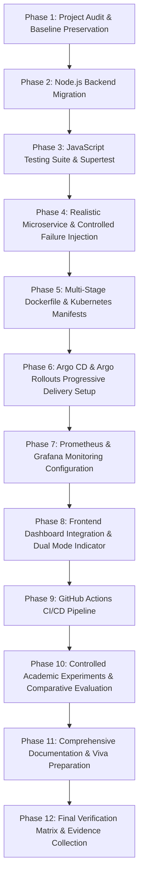

# CLOUD-05: Phase 1 — Comprehensive Baseline Audit & Migration Plan

**Date:** November 1, 2026  
**Project Title:** CLOUD-05 — GitOps-Based CI/CD with Progressive Delivery and Automated Rollback  
**Auditor:** Senior DevOps & Cloud-Native Architect  
**Workspace:** `/Users/vinayakkumar/Desktop/cloud05-capstone`  

---

## 1. Executive Summary

An exhaustive inspection of the existing workspace was performed prior to making any functional changes. The workspace previously contained a working Python/Flask prototype with an interactive DevOps dashboard, an automated end-to-end Python test suite, and a live JSON configuration evaluation engine.

Before performing any migration, the entire repository was initialized under Git version control (`main` branch) and committed to ensure an immutable historical baseline. The existing Python server was verified against the 10-point test suite (`ALL CL-05 CAPSTONE TESTS PASSED in 21.35s`).

This report provides the architectural inventory, categorizes components by real versus simulated status, documents environment constraints, and defines a phased migration plan to transition the backend to a production-grade Node.js/Express architecture while expanding to real GitOps, Kubernetes, Argo Rollouts, and Prometheus capabilities.

---

## 2. Workspace File Inventory

| Path | Size / Lines | Status | Description |
| :--- | :--- | :--- | :--- |
| `backend/app.py` | 438 lines (16.5 KB) | **Active Python Baseline** | Flask server, in-memory progressive delivery state machine, config validator, rollback worker. |
| `backend/release_config.json` | 6 lines (92 B) | **Active Config** | Live disk file read and evaluated by the deployment pipeline (`version`, `message`, `error_rate`, `threshold`). |
| `backend/requirements.txt` | 2 lines (13 B) | **Active Baseline** | Python dependencies (`Flask>=3.0.0`). |
| `backend/test_e2e.py` | 353 lines (15.3 KB) | **Active Baseline** | Comprehensive Python test suite covering health, status, validation, boundary, rollback, and reset. |
| `frontend/index.html` | 208 lines (11.7 KB) | **Active UI** | DevOps dark-mode dashboard (control cards, live config, metrics, traffic distribution bar, rollback card, audit stream). |
| `frontend/css/style.css` | 747 lines (14.5 KB) | **Active UI** | Modern CSS custom properties, responsive layout, status badges, animations (`.pulse-dot`, `@keyframes flash`). |
| `frontend/js/app.js` | 346 lines (13.6 KB) | **Active UI** | Client-side reactive polling engine (1s interval), DOM manipulation, action button handlers. |
| `README.md` | 205 lines (9.2 KB) | **Documentation** | Architectural overview, configuration schema, demonstration guide, API reference. |
| `REVIEW_GUIDE.md` | 256 lines (20.0 KB) | **Documentation** | Deep-dive code walkthrough, real vs. simulated matrix, 15 viva questions & answers. |
| `test_e2e.py` | 16 lines (418 B) | **Root Runner** | Convenience root runner delegating to `backend/test_e2e.py`. |
| `.gitignore` | 15 lines (157 B) | **Config** | Ignores virtual environments, Python bytecode, OS/IDE artifacts. |

---

## 3. Real, Simulated, Incomplete, and Missing Components

To guarantee academic and engineering integrity, the current implementation state is classified below:

### 3.1 Real (Implemented & Verified in Baseline)
1. **HTTP REST API**: Fully functional endpoints (`GET /`, `GET /health`, `GET /api/status`, `GET /api/config`, `GET /api/events`, `POST /api/deploy/healthy`, `POST /api/deploy/faulty`, `POST /api/deploy/current-config`, `POST /api/reset`).
2. **Strict Schema & Range Validation**: Real-time evaluation of `backend/release_config.json` enforcing required fields, string types, numeric bounds `[0, 100]`, and syntax checks. Invalid configurations return HTTP 400 and preserve the active release.
3. **Thread-Safe State Machine**: Synchronized via lock primitives to prevent dirty reads during background canary progression.
4. **Circuit-Breaker Automated Rollback**: Evaluates candidate error rate against threshold; upon violation, sets health to HTTP 503, aborts candidate rollout, and safely restores previous stable version to 100% traffic.
5. **Real-Time Client Dashboard**: Reactive UI polling every 1 second, updating DOM metrics, traffic split bars, rollback alerts, and live event stream.
6. **Chronological Audit Stream**: Bounded ring buffer recording timestamped events (`info`, `warning`, `danger`, `success`).

### 3.2 Simulated (In Baseline)
1. **Traffic Splitting**: Ratios (`90/10` -> `50/50` -> `100/0`) are state-driven programmatic values rather than real packet routing via Envoy, Istio, or Kubernetes Ingress.
2. **Health Probes**: Synthetic checks based on configured error rates rather than live application traffic telemetry.
3. **Rollout Execution**: Background thread with `sleep()` simulating canary step duration rather than an external cluster operator.

### 3.3 Incomplete / Missing (Required for Full Capstone Objective)
1. **JavaScript/Node.js Backend**: Python/Flask must be replaced with Node.js & Express with proper modular architecture (`src/routes`, `src/services`, `src/controllers`, `src/middleware`).
2. **JavaScript Test Framework**: Migration of `test_e2e.py` to Jest/Vitest and Supertest.
3. **Prometheus Telemetry**: Real `/metrics` endpoint with Prometheus metrics (`http_requests_total`, `http_request_duration_seconds`, `rollout_status`, `release_health`) using `prom-client`.
4. **Realistic Demo Microservice Operations**: Endpoints demonstrating business logic, version reporting (`/version`, `/ready`), and safe failure injection modes for controlled experiments.
5. **Containerization**: Multi-stage Dockerfile with non-root security context and container health checks.
6. **Kubernetes & Argo Rollouts Manifests**: Real manifests (`Rollout`, `AnalysisTemplate`, `Service`, `ConfigMap`) supporting progressive canary releases.
7. **Argo CD Application**: GitOps repository configuration for continuous reconciliation.
8. **GitHub Actions CI/CD**: End-to-end pipeline covering lint, test, build, scan, and GitOps manifest update.
9. **Controlled Academic Experiments**: Comparative evaluation measuring error rate, blast radius, failure detection time, and recovery time between conventional vs. progressive delivery.
10. **Dual Execution Mode**: Dashboard toggle clearly distinguishing between "Local Simulation Mode" and "Kubernetes / Argo CD Connected Mode".

---

## 4. Local Environment & Infrastructure Assessment

- **Operating System**: macOS (Darwin 24.3.0, arm64)
- **Node.js**: v26.4.0 (Installed at `/opt/homebrew/bin/node`)
- **npm**: v11.17.0 (Installed at `/opt/homebrew/bin/npm`)
- **Docker**: Installed at `/usr/local/bin/docker` (Daemon currently stopped)
- **Kubectl**: Installed at `/opt/homebrew/bin/kubectl` (Contexts: `kind-cloud05`, `minikube`, `docker-desktop`)
- **Helm**: Installed at `/opt/homebrew/bin/helm`
- **Kind**: Installed at `/opt/homebrew/bin/kind`
- **Minikube**: Installed at `/opt/homebrew/bin/minikube`

*Implication:* The host has all necessary tooling installed. Because Docker daemon is currently stopped, the application will provide a dual-mode operational capability: full local development/simulation mode with real Node.js and Prometheus metrics, plus complete Kubernetes/Argo Rollouts infrastructure manifests ready for cluster deployment.

---

## 5. Phase-by-Phase Migration Strategy

### Next Steps for Phase 2:
1. Initialize `backend/package.json` with ES Module support.
2. Install production dependencies (`express`, `prom-client`, `dotenv`) and dev dependencies (`vitest`, `supertest`).
3. Construct modular architecture:
   - `backend/src/app.js`
   - `backend/src/server.js`
   - `backend/src/config/environment.js`
   - `backend/src/services/state.service.js`
   - `backend/src/services/config.service.js`
   - `backend/src/services/rollout.service.js`
   - `backend/src/services/event.service.js`
   - `backend/src/routes/` (health, deployment, config, events, status, metrics)
   - `backend/src/middleware/validation.js`, `error-handler.js`
4. Guarantee 100% backward compatibility with all frontend expectations and `release_config.json`.
5. Keep Python files untouched until the JavaScript backend is fully validated.
